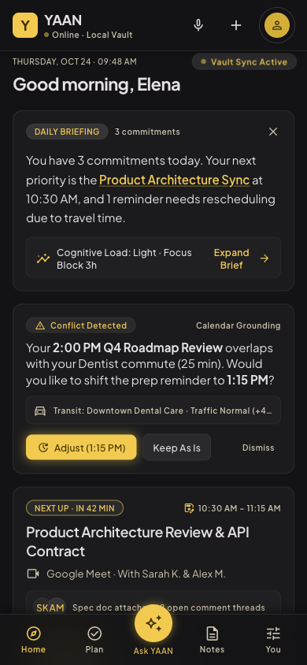
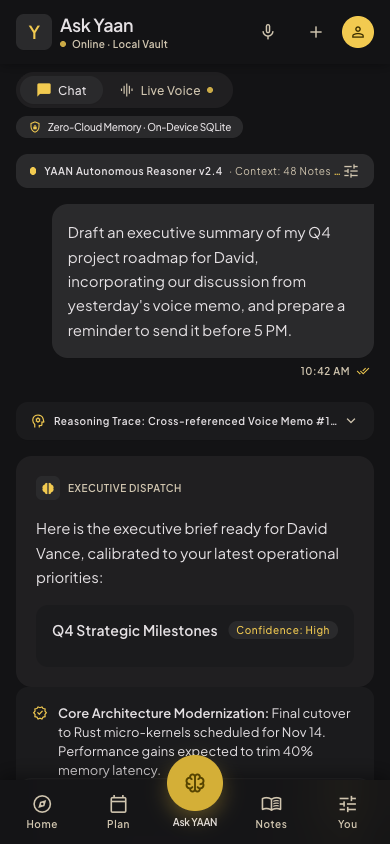
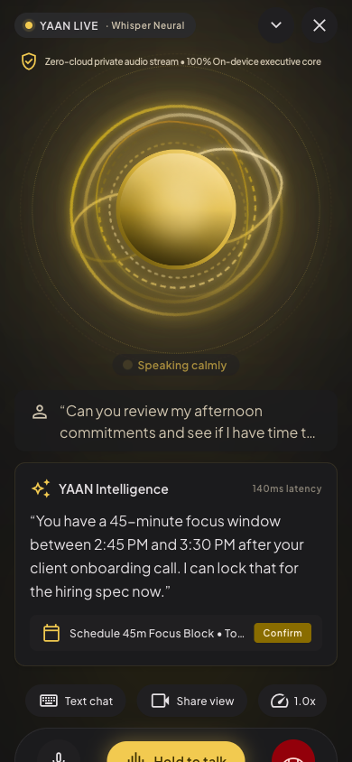
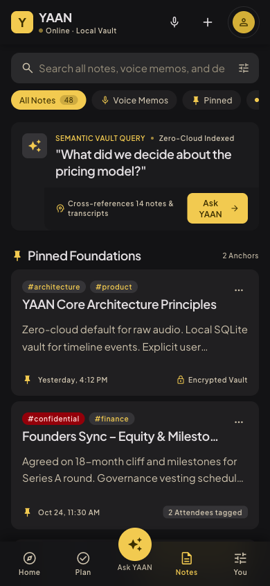

# YAAN — Your Autonomous Action Navigator

<div align="center">

[](LICENSE)
[](https://kotlinlang.org)
[](https://www.jetbrains.com/lp/compose-multiplatform/)
[](docs/security/SECURITY_AND_PRIVACY.md)
[]()

> *Remember less. Do more. Live better.*

**YAAN** is a sovereign, privacy-first, local-first personal AI operating system for high-output professionals. It unifies tasks, encrypted notes, smart reminders, audio memos, and proactive daily briefings into a single cross-platform application — with zero-knowledge architecture ensuring your personal data never touches cloud servers in plaintext.

[Features](#-what-yaan-does) • [Architecture](#-architecture) • [Security & Privacy](#-security-posture) • [Quickstart](#-getting-started) • [Contributing](CONTRIBUTING.md) • [Documentation](docs/)

</div>

---

<p align="center">
  
  
  
  
</p>

---

## ✦ What YAAN Does

| Capability | How It Works |
|---|---|
| **Instant Capture** | Tap, type, or speak — thoughts are triaged into tasks, notes, or reminders in < 150ms using on-device deterministic NLP intent detection. |
| **Encrypted Notes Vault** | Every note is encrypted with AES-GCM-256 before touching disk. Search, tag, pin, and export your knowledge base offline. |
| **Smart Reminders** | Natural language scheduling with typo tolerance ("tommoroww 2pm"), relative dates ("tonight"), and auto-rescheduling. |
| **Ask YAAN Assistant** | Grounded Q&A over your encrypted vault — YAAN answers from *your* data with citations, eliminating hallucinations. |
| **Live Voice Mode** | Push-to-talk with real-time speech synthesis in 3 voice profiles (British, American, Australian) and speed control. |
| **Daily Briefing** | Pre-computed overnight, rendered at 0ms on wake-up: today's commitments, conflicts, and cognitive load score. |
| **Two-Phase Actions** | YAAN proposes actions (reschedule, draft, create) — nothing executes without your explicit tap. Full undo support. |
| **Privacy by Architecture** | Deterministic operations work 100% offline. Cloud is opt-in, consented, and zero-knowledge. |

---

## ✦ Architecture

YAAN follows a clean modular architecture with strict separation between deterministic on-device operations and probabilistic cloud intelligence:

```
yaan/
├── composeApp/                   # Compose Multiplatform UI + Local AI Engine
│   └── src/
│       ├── commonMain/           # Shared screens, theme, components, AI engine
│       ├── androidMain/          # Android Activity, notifications, Keystore
│       └── iosMain/              # iOS MainViewController bridge & Keychain
├── core/
│   ├── common/                   # Dispatchers, Result<T>, datetime, logging
│   ├── domain/                   # Entities, use cases, repository interfaces (zero deps)
│   └── data/                     # SQLDelight DB, AES-GCM cipher, CRDT, Ktor
├── feature/
│   ├── capture/                  # Instant capture & auto-triage inbox
│   ├── reminders/                # Defense-in-depth alarm stack
│   ├── notes/                    # Encrypted vault CRUD & FTS5 search
│   ├── tasks/                    # Task trees & auto-closing loops
│   ├── briefing/                 # Morning briefing & proactive assistance
│   ├── memory/                   # Epistemic memory with confidence scoring
│   ├── voice/                    # On-device voice & Edge SLM parsing
│   └── actions/                  # External tool connectors & approval gates
├── backend/                      # Ktor server: CRDT blind relay, inference mesh, vault backup
├── shared/                       # KMP platform bridge (expect/actual)
├── iosApp/                       # Native iOS Xcode project
├── docs/                         # Architecture, Security, Design, and ADR specifications
└── gradle/                       # Version catalog & wrapper
```

### Architectural Invariants (Non-Negotiable)

1. **Deterministic State Decoupled from AI** — Saving notes, toggling tasks, scheduling reminders always succeed 100% offline without LLM availability.
2. **Zero-Knowledge Privacy** — All vault content is AES-GCM-256 encrypted on-device before any cloud transmission. The server is a blind relay.
3. **Sub-150ms Interaction Ceiling** — On-device processing at 0ms baseline; cloud-assisted queries stream with TTFT < 150ms.
4. **Pre-computed Async Intelligence** — Daily briefings are synthesized overnight and delivered as pre-computed payloads for 0ms wake-up rendering.

---

## ✦ Tech Stack

| Layer | Technology |
|---|---|
| **Language** | Kotlin 2.0.21 |
| **UI Framework** | Compose Multiplatform 1.7.0 (Material 3) |
| **Database** | SQLDelight 2.0.2 (Local SQLite, reactive Flow observers) |
| **Encryption** | AES-GCM-256 with hardware-backed key management (Android Keystore / iOS Keychain) |
| **Networking** | Ktor 3.0.1 (HTTP/3 QUIC, 0-RTT connection pooling) |
| **Dependency Injection** | Koin 4.0.0 |
| **Serialization** | Kotlinx Serialization 1.7.3 (JSON + Protobuf) |
| **Concurrency & Time** | Kotlinx Coroutines 1.9.0, Kotlinx DateTime 0.6.1 |
| **Sync Protocol** | Multi-Value Register CRDT with Lamport timestamps & vector clocks |
| **Backend Relay** | Ktor Server 3.0.1 on Netty (JVM 21) |
| **Build System** | Gradle 8.9 with Version Catalogs & Type-Safe Accessors |
| **Design Language** | Executive Kinetic Minimalism |

---

## ✦ Security Posture

* **AES-GCM-256** authenticated encryption at rest for all vault notes (hardware-backed keys on Android Keystore / iOS Keychain).
* **Biometric vault lock** gate with Touch ID / Face ID before vault access.
* **Passkey** Secure Enclave registration for cloud escrow.
* **Zero plaintext logging** — no vault content ever appears in logs, crash reports, or network traces.
* **Prompt injection defense** — `VaultUntrustedContentGuard` with comprehensive red-team injection test suite.
* **BOLA defense** — AuthGuard enforced across all backend endpoints.
* **GDPR Article 17** — atomic crypto-shredding with SHA-256 verifiable certificates.

For vulnerability reporting, see [SECURITY.md](SECURITY.md).

---

## ✦ Documentation Index

The repository maintains comprehensive technical documentation under [`docs/`](docs/):

| Category | Directory | Purpose |
|---|---|---|
| **Architecture** | [`docs/architecture/`](docs/architecture/) | [Product Vision](docs/architecture/YAAN_PRODUCT_VISION_v2.md), [AI System Architecture](docs/architecture/YAAN_AI_SYSTEM_ARCHITECTURE.md), [Cost Model](docs/architecture/COST_MODEL.md) |
| **Architecture Decision Records** | [`docs/adr/`](docs/adr/) | 8 Ratified Architecture Decision Records (ADR 0001–0008) covering KMP, SQLite, Hybrid Inference, and Auth |
| **Security & Privacy** | [`docs/security/`](docs/security/) | [Security & Privacy Specification](docs/security/SECURITY_AND_PRIVACY.md), [Threat Model](docs/security/THREAT_MODEL.md) |
| **Design & UI Specifications** | [`docs/design/`](docs/design/) & [`stitch_designs/`](docs/stitch_designs/) | Design assets, UI component blueprints, and mobile prototypes |

---

## ✦ Getting Started

### Prerequisites
* JDK 17 or JDK 21
* Android Studio Ladybug (2024.2+) or IntelliJ IDEA Ultimate
* Xcode 16+ (for iOS build)

### Build Commands

```bash
# 1. Clone repository
git clone https://github.com/developmentwithyash/yaan.git
cd yaan

# 2. Run multiplatform unit tests
./gradlew test

# 3. Launch Desktop Application (macOS, Linux, Windows) — No mobile SDK needed!
./gradlew :composeApp:run

# 4. Build Android Debug APK
./gradlew :composeApp:assembleDebug
# Output at: composeApp/build/outputs/apk/debug/composeApp-debug.apk

# 5. Run Ktor Backend Relay locally
./gradlew :backend:run

# 6. Open iOS project in Xcode
open iosApp/iosApp.xcodeproj
```

---

## ✦ Contributing

Contributions are welcome! Please read our [Contributing Guidelines](CONTRIBUTING.md) and [Code of Conduct](CODE_OF_CONDUCT.md) before submitting pull requests.

---

## ✦ Contact & Maintainer

For questions, collaborations, or private vulnerability disclosures, reach out to the project maintainer:

* **Maintainer**: Yash Siwach
* **Email**: [`work.developmentwithyash@gmail.com`](mailto:work.developmentwithyash@gmail.com)
* **GitHub**: [@developmentwithyash](https://github.com/developmentwithyash)

---

## ✦ License

This project is licensed under the **Apache License 2.0** - see the [LICENSE](LICENSE) file for details.

```
Copyright 2026 YaanStack Technologies & Contributors

Licensed under the Apache License, Version 2.0 (the "License");
you may not use this file except in compliance with the License.
You may obtain a copy of the License at

    http://www.apache.org/licenses/LICENSE-2.0
```
