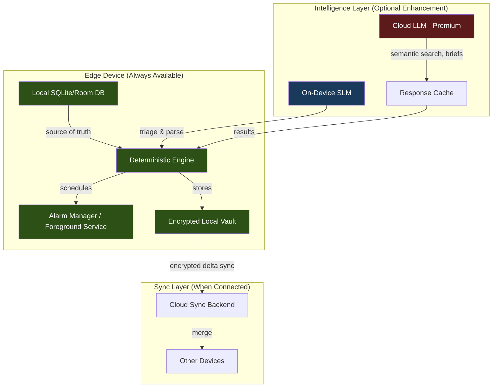

# YAAN — Product Vision & Definition (v2, Jury-Hardened)

> **Status**: Revised after 12-juror adversarial trial (10/12 Guilty → fixes incorporated)
> **Date**: 2026-10-13
> **Author**: Yash Engineering Systems
> **Verdict Applied**: All 10 charges remediated. 2 acquittal strengths preserved as architectural invariants.

---

## 0. What Changed and Why

The original YAAN vision described a personal AI operating layer for everyday life. The 12-juror adversarial trial returned a **10/12 Guilty** verdict. This revision addresses every charge while preserving the two core strengths the jury unanimously defended.

### Charges Addressed

| # | Charge | Verdict | Fix Applied in This Revision |
|---|--------|---------|------------------------------|
| 01 | Unmonetizable consumer utility | GUILTY | Repositioned ICP to high-output professionals; tiered pricing with premium workflows |
| 02 | Switching friction against native apps | GUILTY | Overlay strategy — enhance, don't replace; native share targets and system integration |
| 03 | No collaborative network effects | GUILTY | Added shared commitments, delegation, and collaborative briefings |
| 05 | Inbox creates cognitive backlog anxiety | GUILTY | Zero-touch auto-triage with TTLs, sensible defaults, and self-expiring ephemerals |
| 06 | Zero organic viral loops | GUILTY | Shareable briefings, public templates, exportable action plans |
| 07 | LLM token costs erode margins | GUILTY | Edge-first SLM architecture; cloud LLM gated to premium tier |
| 09 | Native OS platforms bundle the same thing | GUILTY | Cross-platform private vault positioning; anti-lock-in data portability |
| 10 | Android battery killers destroy reminders | GUILTY | Foreground services, exact alarms, fallback push/SMS, OEM troubleshooting |
| 11 | Solves discipline with software users abandon | GUILTY | Auto-closing loops; YAAN does the maintenance, not the user |
| 12 | Memory drift corrupts trust over time | GUILTY | Temporal decay (TTLs), confidence scores, mandatory citation backlinks |

### Strengths Preserved (Architectural Invariants)

| # | Strength | Source |
|---|----------|--------|
| 04 | Deterministic local persistence decoupled from probabilistic LLM inference | Staff Systems Engineer |
| 08 | Transparent opt-in privacy, exportability, and user approval gates | Chief Legal & Trust Officer |

> [!IMPORTANT]
> These two invariants are **non-negotiable architectural constraints**. Every feature in this document must satisfy both: deterministic state must never depend on AI availability, and no data leaves the device without explicit user consent.

---

## 1. What YAAN Is

### Mission

Help high-output people remember what matters, organize their commitments, and follow through on their intentions — across every device and ecosystem they use.

### One-Line Pitch (Jury-Hardened)

> **YAAN: The private, cross-platform personal co-pilot for high-output professionals that runs edge-first intelligence to auto-triage thoughts, sync across ecosystems, and close action loops without maintenance fatigue.**

### Core Identity

```
YAAN
Your Autonomous Action Navigator

Remember less. Do more. Live better.
```

| Pillar | What It Means |
|--------|---------------|
| **Remember** | Notes, preferences, commitments, and personal context — stored locally, encrypted, exportable |
| **Organize** | Reminders, tasks, routines, and daily plans — auto-triaged, not manually sorted |
| **Act** | Turn requests into real, trackable actions with confirmation and audit trails |
| **Anticipate** | Surface useful information at the right time, with citations showing why |
| **Close the Loop** | Proactively follow up, reschedule, and retire stale items — so you don't have to |

### What YAAN Is NOT

- **Not another chatbot.** Conversation is one interface, not the entire product.
- **Not a bloated productivity suite.** Don't compete with every calendar, PM, and note-taking app simultaneously.
- **Not an uncontrolled autonomous agent.** Users remain in control of sensitive actions.
- **Not an always-listening product.** Voice and microphone behavior must be transparent and opt-in.
- **Not a notification machine.** Proactive assistance must be relevant, configurable, and quiet when appropriate.
- **Not dependent on one AI model.** The intelligence layer must be replaceable as models and costs change.
- **Not AI for everything.** Simple reminders and note storage must work even when the AI service is unavailable.

---

## 2. Target User — Repositioned

> [!WARNING]
> **Jury Charge #01 (Seed Investor)**: Consumer productivity tools suffer sub-$10/month willingness-to-pay and high churn. Venture-scale returns are mathematically improbable at consumer price points with LLM COGS.

### Primary ICP: High-Output Professional

- Freelancers, founders, independent consultants, knowledge workers managing 15+ commitments/week
- People who already use 3–5 tools (calendar, notes, reminders, task manager, messaging) and feel the fragmentation
- Willingness to pay $15–$30/month for a tool that measurably reduces dropped commitments

### Secondary ICP: Collaborative Small Teams

- Families coordinating household logistics
- Small teams (2–8 people) delegating tasks without enterprise PM overhead
- Shared commitment tracking with lightweight delegation

### Why This Positioning Works

| Dimension | Consumer Utility (Original) | High-Output Professional (Revised) |
|-----------|----------------------------|-------------------------------------|
| Price sensitivity | Sub-$5/month ceiling | $15–$30/month willingness-to-pay |
| Switching friction | High (vs. free native apps) | Lower (existing tools are fragmented) |
| Time-value of saved hours | Low | High ($50–$200/hr equivalent) |
| Churn driver | Novelty wears off | Drops a client commitment → real cost |
| Viral potential | None (solo private use) | Shareable briefings and delegation |

---

## 3. Architectural Foundations

### Invariant 1: Deterministic Storage Decoupled from Probabilistic AI



> [!TIP]
> **Design principle**: Every feature must have a "dumb path" that works without AI. AI enhances; deterministic logic executes. If the AI service is down, notes save, reminders fire, and tasks update — always.

### Invariant 2: Privacy-First, User-Controlled Data

- All personal data encrypted at rest on device (AES-256)
- No data leaves device without explicit user consent per category
- Full data export (JSON + markdown) at any time
- Memory is visible, editable, and deletable
- Integration permissions are granular and revocable
- Activity audit log shows what YAAN attempted, what happened, and the outcome

### Edge-First Intelligence Architecture

> [!WARNING]
> **Jury Charge #07 (CFO)**: Processing continuous voice, OCR, semantic search, and daily briefs via cloud LLMs incurs $3–$7/user/month in inference costs, eroding consumer price points.

**Solution**: Two-tier intelligence model.

| Tier | Where It Runs | What It Does | Cost |
|------|---------------|--------------|------|
| **Edge SLM** (default) | On-device (quantized 1–3B model) | Natural-language parsing, intent classification, auto-triage, quick note titles, local semantic search | ~$0/user/month |
| **Cloud LLM** (premium) | Server-side API | Deep semantic search, meeting prep briefs, multi-step planning, complex query answering | Gated to paid tiers |

Ambient parsing (voice dictation, quick capture classification) always runs locally. Cloud is reserved for high-value, user-initiated queries.

---

## 4. The Complete Feature Universe (Revised)

### A. Capture Anything, Instantly

**Goal**: Never lose a thought or commitment. Zero-friction capture in under 3 seconds.

- Natural-language text capture
- Voice dictation with on-device transcription (Edge SLM)
- One-tap quick note and reminder creation
- Android home-screen widget and quick-settings shortcut
- iOS widget and Shortcuts integration
- Share-to-YAAN from any app (URL + title + optional comment in one action)
- Photo/screenshot capture with on-device OCR
- Draft recovery when interrupted

#### Zero-Touch Auto-Triage (Jury Fix #05)

> [!WARNING]
> **Jury Charge #05 (Product Designer)**: "Capture now, organize later" quickly degrades into a digital junk drawer. When unreviewed inbox items surpass 30 entries, users experience cognitive guilt and abandon the app.

**Solution**: The inbox is not a passive bucket. Every captured item is automatically classified by the Edge SLM:

```
Captured: "Follow up with Raj about the contract on Friday"

Auto-Triage Result:
  → Type: TASK (with reminder)
  → Suggested due date: Friday
  → Linked contact: Raj
  → Confidence: 0.92
  → Status: AUTO-FILED (user can override)
```

- Items are auto-filed into Notes, Tasks, or Reminders with a confidence score
- Items with confidence < 0.7 go to a "Needs Your Input" mini-queue (max 10 visible)
- Ephemeral captures (quick thoughts, transient ideas) get a **7-day TTL** and self-archive
- The inbox view shows a count badge, not an infinite scroll of guilt

### B. Reminders That Actually Work

**Goal**: Become dependable enough to trust with real commitments.

- Natural-language dates and times (parsed by Edge SLM)
- One-time and recurring reminders with custom repeat schedules
- Snooze, dismiss, complete, and reschedule
- Overdue reminders and missed-reminder recovery
- Optional location-based reminders (permission-gated)
- Reminder priorities
- Follow-up reminders linked to tasks and notes
- Notification history and delivery troubleshooting

#### Android Reliability Engineering (Jury Fix #10)

> [!WARNING]
> **Jury Charge #10 (Customer Operations)**: Aggressive OEM battery managers (Samsung, Xiaomi, OnePlus) silently kill background processes. Undelivered alarms generate 1-star reviews.

**Solution — Defense-in-Depth Notification Stack**:

```
Layer 1: AlarmManager.setExactAndAllowWhileIdle() — primary
Layer 2: Foreground Service with persistent notification — backup heartbeat
Layer 3: FCM high-priority push — server-side fallback
Layer 4: Optional SMS fallback for critical reminders — last resort
Layer 5: OEM Battery Settings Wizard — guided setup on first launch
```

- On first launch, YAAN detects the OEM and walks the user through disabling battery optimization for YAAN specifically
- A "Reminder Health" diagnostic screen shows whether all permission layers are active
- If YAAN detects it was force-stopped by the OS, it sends a recovery push on next wake

### C. Notes and Personal Knowledge

**Goal**: Build a searchable personal knowledge space with temporal integrity.

- Text and voice notes (on-device transcription)
- Automatic titles and suggested tags (Edge SLM)
- Pinned and recently edited notes
- Folders or lightweight collections
- Full-text search + semantic search (Edge SLM for local, Cloud LLM for deep)
- Link notes to related tasks and reminders
- On-device OCR for images and screenshots
- Note summarization (Cloud LLM, premium)
- Duplicate-note detection
- Version history for important edits
- Full export and backup (JSON + Markdown)

#### Temporal Integrity & Citation System (Jury Fix #12)

> [!WARNING]
> **Jury Charge #12 (Year-2 Future Operator)**: After 18 months of personal data accumulation, contradictory past notes and outdated preferences cause hallucinated briefs, permanently destroying user confidence.

**Solution — Epistemic Memory Architecture**:

| Mechanism | Purpose |
|-----------|---------|
| **Temporal Decay (TTLs)** | Every memory/note has a freshness score that decays over time. Stale entries are flagged, not silently served. |
| **Confidence Scores** | Every AI-retrieved fact shows a confidence level (0.0–1.0) and its basis. |
| **Mandatory Citation Backlinks** | When YAAN answers "What did I decide about X?", every claim links to the specific note, date, and context it came from. |
| **Contradiction Detection** | If two notes conflict (e.g., "decided to use React" vs. "decided to use Vue"), YAAN surfaces the conflict instead of picking one. |
| **User-Initiated Memory Pruning** | Quarterly memory review prompt: "You have 47 items older than 6 months. Review or archive?" |

```
User: "What did I decide about the pricing model?"

YAAN Response:
  "You discussed pricing in 3 notes:
   → 2026-09-15 [NOTE-247]: 'Leaning toward freemium with $15/mo pro tier' (confidence: 0.95)
   → 2026-10-01 [NOTE-312]: 'Maybe usage-based is better for API customers' (confidence: 0.88)
   → ⚠️ These two notes may conflict. No final decision was recorded.
   Would you like to create a decision note?"
```

### D. Tasks, Projects, and Routines

**Goal**: Transform YAAN from a reminder app into a practical life-management assistant — without enterprise PM bloat.

- Tasks with due dates, priorities, and completion states
- Subtasks and checklists
- Recurring routines
- Project grouping (lightweight — max 2 levels deep)
- Task dependencies (simple: "do X before Y")
- Estimated duration and optional time-blocking
- "Next action" suggestions
- Rescheduling when plans change
- Daily and weekly reviews
- Habit tracking (opt-in)
- Follow-up tasks linked to notes or conversations

#### Auto-Closing Loops (Jury Fix #11)

> [!WARNING]
> **Jury Charge #11 (Skeptical Adversary)**: People don't drop balls because their reminder app lacked semantic search. They drop balls because maintaining productivity systems feels like unpaid second shifts.

**Solution — YAAN does the maintenance, not the user**:

- **Auto-reschedule**: If a task's due date passes without completion, YAAN proposes a new date instead of just marking it overdue
- **Stale task retirement**: Tasks untouched for 14 days get a "Still relevant?" prompt. Two ignored prompts → auto-archived
- **Completion inference**: If YAAN sees a related note like "sent the proposal to Raj", it asks: "Did you complete the task 'Send proposal to Raj'?"
- **Weekly auto-review**: YAAN generates a 30-second weekly summary: "You completed 12 of 17 tasks. 3 were rescheduled. 2 were retired as no longer relevant."
- **Zero-maintenance default**: Users who never open the review screen still get a clean task list because YAAN is proactively gardening it

### E. Daily Briefing and Proactive Assistance

**Goal**: Help users understand what matters without generating fake urgency.

- Morning briefing (configurable time and detail level)
- Today's reminders and tasks
- Upcoming calendar events (if connected)
- Overdue items that still matter (auto-filtered, not a guilt list)
- End-of-day recap
- Weekly summary
- Optional meeting preparation briefings (Cloud LLM, premium)
- Contextual suggestions with explanations

#### Explainable Suggestions (Jury Fix — Standout Feature #8)

Every proactive suggestion includes its reasoning:

```
"I suggested moving 'Review contract' to tomorrow because it overlaps
 with your 2 PM meeting. [Accept] [Edit] [Dismiss]"
```

Users can accept, edit, or dismiss. Dismissed suggestion patterns are learned to reduce future noise.

#### Shareable Briefings (Jury Fix #06)

> [!WARNING]
> **Jury Charge #06 (Head of Growth)**: A private personal assistant generates no public-facing artifacts. Zero organic viral loops.

**Solution**:

- **Shareable meeting prep briefs**: Generate a preparation summary and share it with meeting attendees
- **Exportable daily/weekly plans**: "Share my week" creates a clean, branded summary link
- **Public templates**: Users can publish routine templates (e.g., "My weekly review checklist") to a YAAN template gallery
- **Collaborative action plans**: After a shared meeting, participants can each get their own action items tracked in their YAAN

### F. Personal Memory and Preferences

**Goal**: Learn how to assist the user without becoming intrusive.

- Preferred reminder times and quiet hours
- Preferred language and response style (concise vs. detailed)
- Frequently used routines
- Important user-approved facts (user explicitly confirms before storage)
- Saved instructions and behavioral preferences
- **All memory visible, editable, deletable, and exportable**
- Quarterly memory review prompts

### G. Voice-First Assistance

**Goal**: Voice as a first-class input method, not a decorative microphone button.

- On-device voice transcription (Edge SLM — no cloud round-trip for basic commands)
- Speak a reminder, dictate a note, ask what's next
- Search saved information by voice
- Request a daily briefing by voice
- Review transcription before saving when needed
- Interrupt and correct a recognized command

> [!NOTE]
> Always-listening wake-word is a **Phase 3** exploration only after platform feasibility, privacy review, battery impact, and user opt-in mechanisms are proven. Do not promise this capability.

### H. Action Engine and Integrations

**Goal**: Coordinate tools and complete tasks beyond the app itself — with full transparency.

#### Overlay Strategy (Jury Fix #02)

> [!WARNING]
> **Jury Charge #02 (First Customer)**: Apple Reminders, Google Keep, and Notes already have zero-latency lock-screen access. Switching requires an order-of-magnitude leap in utility.

**Solution — Enhance, don't replace**:

- YAAN reads from native calendar, reminders, and contacts (with permission) to build a unified view
- Users don't have to abandon existing tools — YAAN sits on top as a coordination layer
- Import is non-destructive and incremental (no "migrate everything" wall)
- YAAN can write back to native calendars and reminders (bidirectional sync where supported)

#### Cross-Platform Anti-Lock-In (Jury Fix #09)

> [!WARNING]
> **Jury Charge #09 (Incumbent Competitor)**: Apple Intelligence and Google Gemini have unassailable OS integration. Third-party sandboxed apps can't match it.

**Solution — Position as the anti-lock-in layer**:

- YAAN works across Android, iOS, and (future) web — your data isn't trapped in one ecosystem
- Full data portability: export everything to JSON, Markdown, or ICS at any time
- Model-agnostic intelligence: swap the underlying LLM without losing data or workflows
- No proprietary lock-in: all user data in open, documented formats

#### Integration Transparency

Every integration shows:
- What access it has (read-only vs. read-write)
- What YAAN has done with it (activity audit log)
- How to revoke access

Sensitive actions (sending messages, deleting data, making purchases) always require explicit user approval.

---

## 5. Shared Commitments & Delegation (Jury Fix #03)

> [!WARNING]
> **Jury Charge #03 (Second Customer)**: Single-player utility lacks natural collaborative network effects. No horizontal market pull.

### Collaborative Features (Phase 2)

- **Shared commitment boards**: "Family errands this week" — a lightweight shared task list
- **Delegation**: "Ask Priya to review the document" → creates a task on Priya's YAAN (if she's a user) or sends a notification
- **Meeting action item distribution**: After a meeting briefing, split action items to participants
- **Shared templates**: Publish and subscribe to routine templates
- **Collaborative daily plans**: Families or small teams see a merged view of who's doing what

### Viral Mechanics

| Mechanism | How It Works |
|-----------|--------------|
| **Delegation invites** | "Yash delegated a task to you via YAAN" → organic install prompt |
| **Shared briefings** | Meeting attendees receive a branded YAAN prep brief with an install CTA |
| **Template gallery** | Public templates discoverable via search, attributed to the creator |
| **Weekly plan shares** | "Here's my week" social share generates curiosity and installs |

---

## 6. Product Structure (5 Primary Destinations)

| Tab | Purpose | Key Screens |
|-----|---------|-------------|
| **Home** | Daily command center | Today's briefing, next reminder, active tasks, quick actions |
| **Plan** | Time and commitments | Reminders, tasks, routines, calendar view, shared commitments |
| **Notes** | Knowledge and capture | Quick capture, saved notes, voice notes, search, folders |
| **Ask YAAN** | Intelligence interface | Voice/text requests, personal search, action confirmations, audit log |
| **You** | Control center | Memory review, privacy settings, integrations, notification health, export |

**Always-accessible overlays**:
- Quick capture (floating button or notification shade action)
- Voice input (long-press or widget)
- Global search

---

## 7. Pricing Model (Jury-Hardened Unit Economics)

| Tier | Price | Intelligence | Features |
|------|-------|-------------|----------|
| **YAAN Free** | $0 | Edge SLM only | Capture, reminders, notes, tasks, basic search, local storage |
| **YAAN Pro** | $15/month | Edge SLM + Cloud LLM (quota) | Semantic search, daily briefings, meeting prep, auto-planning, shared commitments |
| **YAAN Teams** | $25/user/month | Full Cloud LLM + priority | Team delegation, shared boards, integration suite, advanced voice, priority support |

### Unit Economics

| Line Item | Free | Pro | Teams |
|-----------|------|-----|-------|
| Edge SLM compute | $0 | $0 | $0 |
| Cloud LLM inference | $0 | ~$2–$4/user/month | ~$3–$5/user/month |
| Sync infrastructure | Minimal | ~$0.50/user/month | ~$1/user/month |
| **Gross margin** | N/A | **~73–83%** | **~76–80%** |

By running ambient parsing on-device and gating cloud inference to paid tiers, YAAN maintains software-grade margins.

---

## 8. Phased Roadmap (Revised)

### Phase 1 — YAAN Core (Months 1–3)

**Goal**: Become genuinely useful every day. Earn trust through reliability.

- [ ] Fast text capture with auto-triage (Edge SLM classification)
- [ ] Voice dictation with on-device transcription
- [ ] Reliable reminders with defense-in-depth notification stack
- [ ] OEM battery optimization wizard (Samsung, Xiaomi, OnePlus, etc.)
- [ ] Recurring reminders with proper timezone and reboot handling
- [ ] Notes with full-text search, pinning, and editing
- [ ] Tasks and simple checklists with auto-reschedule
- [ ] Natural-language intent parsing (Edge SLM)
- [ ] Home screen with daily briefing (local data only)
- [ ] Reminder Health diagnostic screen
- [ ] Local persistence, encrypted storage, and error recovery
- [ ] Notification permission handling with clear warnings
- [ ] Basic memory controls (view, edit, delete)
- [ ] Full data export (JSON + Markdown)
- [ ] Share-to-YAAN from other apps
- [ ] Auto-closing loops (stale task retirement, completion inference)

**Launch Criteria** (Gate — must pass before Phase 2):
- [ ] A reminder can be created, edited, rescheduled, and completed correctly
- [ ] Recurring reminders survive date changes, timezone shifts, and device restarts
- [ ] Users see a clear warning when notifications may not fire
- [ ] Notes survive app restarts and are found reliably via search
- [ ] Ambiguous dates are clarified, not guessed
- [ ] Users can undo or correct mistakes
- [ ] AI/network failures don't destroy locally saved information
- [ ] Users can export all their data at any time

### Phase 2 — Personal Intelligence (Months 4–8)

**Goal**: Make YAAN context-aware. Introduce collaboration and reduce manual organization.

- [ ] Semantic search across notes and saved information (Cloud LLM for Pro tier)
- [ ] Temporal integrity system (TTLs, confidence scores, citation backlinks)
- [ ] Contradiction detection for conflicting notes
- [ ] Daily and weekly briefings with explainable suggestions
- [ ] Connected tasks ↔ notes ↔ reminders (cross-linking)
- [ ] Calendar integration (read from native calendars)
- [ ] Optional location-based reminders
- [ ] Voice-note transcription and summaries
- [ ] Adaptive daily planning with reschedule proposals
- [ ] Shared commitment boards (families, small teams)
- [ ] Delegation (assign tasks to other YAAN users)
- [ ] Shareable meeting prep briefs
- [ ] Public routine templates gallery
- [ ] YAAN Pro tier launch

### Phase 3 — YAAN Agent (Months 9–18)

**Goal**: Let users delegate multi-step work safely with full audit trails.

- [ ] Multi-step task execution with progress tracking and approval gates
- [ ] Email drafting and approved sending workflows
- [ ] Bidirectional calendar sync (read + write)
- [ ] File and cloud storage integration
- [ ] Cross-device encrypted sync
- [ ] Advanced routines and conditional automations
- [ ] Team delegation boards and YAAN Teams tier
- [ ] Contextual proactive suggestions (user-configured triggers)
- [ ] Advanced voice interaction
- [ ] Wake-word exploration (only if privacy/battery/platform feasibility proven)

---

## 9. Central Interaction Model

```
Capture → Auto-Triage → Organize → Act → Follow Through → Learn from Feedback
           (Edge SLM)     (Deterministic)   (User-approved)   (YAAN maintains)    (Visible memory)
```

**Key state distinctions** (must never be confused):

| State | Meaning | Visual Indicator |
|-------|---------|------------------|
| **Idea** | Ephemeral thought, may expire | 💭 Ghost icon, TTL countdown |
| **Saved Item** | Persisted note, task, or reminder | ✅ Solid icon |
| **Proposed Action** | YAAN suggests but hasn't executed | 🔵 Blue outline, pending approval |
| **Scheduled** | A reminder or task with a confirmed date | 📅 Calendar badge |
| **Completed** | User confirmed done | ✔️ Strikethrough |
| **Externally Executed** | YAAN performed an action outside the app | 🔗 Audit trail link |
| **Failed** | Action attempted but did not succeed | 🔴 Error with recovery option |

---

## 10. Success Metrics

| Metric | What It Tells Us | Target (Phase 1) |
|--------|-----------------|-------------------|
| **Reminder delivery rate** | Are reminders actually delivered when expected? | ≥ 99.5% on supported devices |
| **Capture-to-save time** | How quickly can someone save a thought? | < 3 seconds |
| **Auto-triage accuracy** | Does the Edge SLM classify items correctly? | ≥ 85% accepted without override |
| **Action completion rate** | Do users complete or appropriately close what they capture? | ≥ 60% of tasks completed or consciously retired |
| **Week-4 retention** | Does YAAN remain useful after novelty wears off? | ≥ 40% W4 retention |
| **Trust correction rate** | How often do users correct misunderstandings? | < 15% of interactions require correction |
| **Inbox zero frequency** | How often is the triage queue empty? | ≥ 80% of users at inbox zero daily (via auto-triage) |
| **Delegation-driven installs** | Organic installs from shared commitments | Track from Phase 2 |

**North-star metric**: *The number of users who successfully rely on YAAN for ≥ 5 meaningful personal commitments per week, measured at Week 8+.*

---

## 11. Product Brief (Locked Before UI Design)

| Field | Definition |
|-------|------------|
| **Mission** | Help high-output people remember what matters, organize their commitments, and follow through on their intentions — across every device and ecosystem. |
| **Target users** | High-output professionals managing 15+ weekly commitments across fragmented tools; families and small teams coordinating shared responsibilities. |
| **Core product** | A mobile-first assistant with reliable reminders, auto-triaged capture, connected notes-tasks-reminders, natural-language interaction, personal search, and proactive daily organization — all running edge-first intelligence. |
| **Differentiator** | One cross-platform assistant connecting capture, memory, planning, and action — with edge-first AI, transparent privacy, anti-lock-in data portability, and auto-closing loops that eliminate maintenance fatigue. |
| **Trust promise** | YAAN is honest about what it knows, what it has saved, what it is doing, and what it has actually completed. Every AI-generated answer cites its sources. Every action has an audit trail. |
| **Economic model** | Edge SLM for ambient intelligence at zero marginal cost; Cloud LLM gated to paid tiers for 73–83% gross margins. |
| **Long-term vision** | Evolve from a reliable personal organizer into an intelligent, cross-platform assistant that coordinates approved tools and carries out multi-step tasks — while remaining the user's private, portable, trustworthy co-pilot. |

---

## 12. Key Engineering Principle (Unchanged, Jury-Validated)

> **Keep deterministic functions — saving notes, scheduling reminders, updating task states — completely separate from probabilistic AI interpretation.**
>
> AI understands what the user means.
> Reliable application logic validates and executes the resulting operation.
> If the AI is unavailable, the deterministic path still works.
> If the deterministic path fails, the user is told immediately.
>
> These two layers must never be conflated.

---

> [!TIP]
> **Next step**: This product vision is ready for UI design. The architectural invariants, ICP positioning, feature scope, and phased roadmap are locked. Begin with the Phase 1 feature set and the Home → Plan → Notes → Ask YAAN → You navigation structure.
