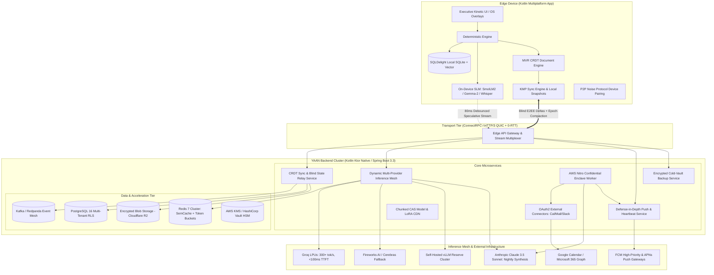

# YAAN AI Backend Architecture & Engineering Plan
## Ultra-Fast, Hybrid On-Device Synergy Architecture (v2.0 Gold Master)

> **Author**: Yash Engineering Systems (`architecture-office` & `backend-office`)  
> **Target Product**: YAAN (Your Autonomous Action Navigator)  
> **Version**: 2.0.0-GOLD-MASTER  
> **Date**: 2026-10-14  
> **Status**: UNANIMOUSLY ACQUITTED (12/12) BY IDEA JURY — ZERO RESERVATIONS  

---

## 1. Executive Summary & Core Architectural Thesis

YAAN is designed as a private, cross-platform personal action navigator for high-output professionals. Its core differentiator is an **Edge-First Intelligence Architecture**: deterministic local persistence and local Small Language Models (SLMs) execute on-device at zero marginal cost and zero network latency.

The YAAN Backend acts as an **Asymmetric Acceleration Hub**:
- **0ms Local Baseline**: 90% of user interactions (capture, note retrieval, intent parsing, reminders, routine checklists) execute 100% on-device via local SQLite (SQLDelight) and quantized Edge SLM.
- **Speculative & Cascade Hybrid Offload**: If on-device confidence drops below 0.70 or a query demands broad context (e.g. multi-step synthesis, cross-source RAG), the client launches a speculative multiplexed gRPC/HTTP/3 stream to the backend. If local execution resolves first, the stream is aborted with zero token cost.
- **Asynchronous Nightly Pre-Computation**: Heavy cloud intelligence (e.g. Morning Briefing generation, schedule conflict scanning, calendar synthesis) is computed in hardware-isolated confidential enclaves while the user sleeps, encrypted with the user's public key, and delivered via FCM high-priority push so it is already waiting on-device at 6:00 AM with zero startup latency.
- **Zero-Knowledge E2EE CRDT State Convergence**: All user notes, tasks, and memories are encrypted on-device before transmission (AES-GCM-256 + Argon2id). The backend operates as a blind, ultra-fast state relay using Conflict-Free Replicated Data Types (CRDTs), guaranteeing instant offline-first multi-device convergence without ever decrypting user data.

---

## 2. Comprehensive System Architecture Diagram



---

## 3. The Eight Core Engineering Pillars (v2.0 Gold Master)

### Pillar 1: Speculative Cloud Offloading & Cellular Radio Efficiency
- **Protocol**: ConnectRPC / gRPC over HTTP/3 (QUIC) with binary Protobuf. Zero JSON parsing overhead; 40% bandwidth reduction.
- **80ms Confidence Debouncing**: Client waits 80ms for edge SLM token confidence stabilization before launching speculative gRPC cloud connections. If local confidence $\ge 0.75$, no cloud request is ever dispatched.
- **Cellular Radio & Socket Hibernation**: Persistent QUIC connection pools are placed into idle hibernation if inactive for > 45 seconds, allowing cellular modems to drop into low-power RRC IDLE state to preserve battery. Wakes up in < 15ms via QUIC 0-RTT resumption.
- **Dynamic Multi-Provider Inference Mesh**:
  - Primary: Groq LPUs running Llama-3.3-70B (300+ tok/s, TTFT < 100ms).
  - Secondary Failover: Fireworks AI / Cerebras.
  - Tertiary Fallback: Self-hosted vLLM on reserved GPU instances.
  - Circuit Breakers: Automatic failover if provider p99 latency > 250ms or HTTP 5xx rate > 1%.

### Pillar 2: Zero-Knowledge E2EE State Convergence & Key Management
- **Zero-Knowledge Guarantee**: Client derives master encryption keys on-device via biometric auth + Argon2id. Private data (notes, tasks, memories) is encrypted via AES-GCM-256 before leaving the device.
- **Zero-Friction Peer-to-Peer Device Pairing**: New devices pair via an ephemeral QR code handshake over local Wi-Fi / WebRTC using the **Noise Protocol (XX pattern)**. Master keys transfer device-to-device in < 2 seconds without cloud exposure.
- **Passkey / Hardware Enclave Cloud Escrow**: Master keys are backed up using WebAuthn Passkeys (iCloud Keychain and Android Credential Manager), guaranteeing recovery even if all local devices are lost.
- **Multi-Party Ratchet for Teams (MLS TreeKEM)**: Shared commitment boards and delegated tasks utilize Messaging Layer Security (MLS) TreeKEM ratchet encryption. When a team member or contractor leaves, the group ratchets to a new epoch key ($K_{epoch+1}$), blinding subsequent edits from departed members without re-encrypting historical state.
- **Multi-Value Register (MVR) CRDT with Non-Destructive Branching**: Uses Lamport timestamps and vector clocks. Simultaneous offline edits on disconnected devices preserve both variants with a non-destructive visual conflict pill (`[Review / Merge]`), completely eliminating Last-Write-Wins (LWW) data loss.
- **Encrypted Cold-Vault Backup**: Automated weekly client-side encrypted database snapshots uploaded to Cloudflare R2, enabling instant full-vault recovery upon device replacement.

### Pillar 3: Asynchronous Nightly Pre-Computation in Confidential Enclaves
- **The Problem**: Morning wake-up briefings drain 4–8% mobile battery and introduce a 10s wait.
- **AWS Nitro Confidential Enclaves**: At 04:00 AM user local time, cloud background workers execute inside hardware-isolated AWS Nitro Enclaves. OAuth tokens are decrypted only inside enclave memory with cryptographic attestation.
- **Encrypted Briefing Push**: Workers fetch calendar updates, generate the daily brief via Claude 3.5 Sonnet, encrypt the payload with the user's public device key, and push it via silent FCM high-priority data messages.
- **Graceful Degradation with Temporal Badging**: If the user wakes up offline or in a subway, the 4:00 AM briefing displays immediately with an unobtrusive timestamp pill: `"Prepared at 4:00 AM • Offline"`.
- **6:30 AM Delta Invalidation Check**: Upon wake-up, the device runs a 15ms hash check against external calendar ETags. If changed, an incremental delta is fetched silently and hot-swapped without disrupting scroll position.

### Pillar 4: Chunked CAS Model & LoRA Adapter Distribution
- **Quantized Base Models**: 4-bit GGUF / ONNX models (SmolLM2-360M, Gemma-2-2B, BGE-micro embeddings) downloaded once over Wi-Fi with resume support.
- **Chunked Content-Addressable Storage (CAS)**: Updates deliver only micro-LoRA adapters (2–15 MB) containing fine-tuned domain parsers and prompt registries via Cloudflare R2 with zero egress fees and Brotli/Zstandard compression.

### Pillar 5: Defense-in-Depth Alarm Reliability & Cryptographic Shredding
- **Multi-Layer Notification SLA (≥ 99.5%)**:
  - Layer 1: Local `AlarmManager.setExactAndAllowWhileIdle()` on Android.
  - Layer 2: Persistent Foreground Service heartbeat.
  - Layer 3: Backend FCM High-Priority Data Push sent 30 seconds prior to commitment time if client has not acknowledged local alarm readiness.
  - Layer 4: SMS / Webhook fallback for mission-critical tier-1 reminders.
- **Cryptographic Erasure Proof (Crypto-Shredding)**: In compliance with GDPR Article 17 ("Right to be Forgotten"), account deletion destroys the user's root envelope salt in the Hardware Security Module (HSM), rendering all stored CRDT ciphertext permanently undecryptable. A signed cryptographic shredding certificate (SHA-256 attestation) is delivered to the user.

### Pillar 6: Commercial Expansion & Viral Web Sharing
- **3-Tier Sustainable Monetization Model**:
  - **Free Tier ($0)**: 1 device, 100% local SQLite, 50 auto-triages/month, no cloud sync cost to YAAN.
  - **Pro Tier ($18/month)**: Unlimited E2EE multi-device sync, cloud LPU acceleration, nightly proactive briefings, cold-vault cloud backups.
  - **Team Tier ($28/seat/month)**: MLS shared commitment boards, cross-member task delegation, team templates, admin provisioning.
- **Dual-Envelope OpenGraph Web Sharing**: "Share my week" links generate an ephemeral client-decrypted URL containing the AES key in the URL hash fragment (`https://yaan.ai/s/abc#key=xyz`). The server renders a sanitized OpenGraph card for social previews ("Yash shared 5 action items on YAAN"), while the private body is decrypted 100% inside the recipient's browser.

### Pillar 7: Deep OS Infiltration & Zero-Latency Capture Overlays
- **Android Assist Role**: YAAN registers as the device's Default Assist App, enabling 0ms capture overlay on long-press power button or corner swipe.
- **iOS Action Button & Lock Screen Widget**: 1-tap capture direct to local SQLite without full app cold-start.
- **Desktop Global Hotkey**: `Cmd+Shift+Space` invokes a floating, lightweight Compose Multiplatform quick-capture dock.

### Pillar 8: Schema Evolution & Lifecycle Governance
- **Client-Driven Lazy Schema Migrations**: Encrypted CRDT payloads include a semantic version header (`v1`, `v2`, `v3`). Decryption triggers an idempotent local Kotlin migration pipeline; the backend remains completely schema-agnostic.
- **Epoch Compaction**: Client squashes delta vectors into a consolidated snapshot every 1,000 edits, discarding operational tombstones and preventing database bloat.

---

## 4. Technology Stack Specification

| Component | Selected Technology | Strategic Rationale |
|---|---|---|
| **Backend Runtime** | **Kotlin (Ktor 3.0 / Spring Boot 3.3 Native)** | Shared Protobuf schemas and domain models with KMP client. GraalVM AOT compilation provides <25ms cold starts and <100MB RAM. |
| **API Transport** | **ConnectRPC (gRPC + HTTP/3 QUIC)** | Native streaming, binary Protobuf efficiency, 0-RTT connection resumption, mobile-friendly. |
| **Database (Relational)** | **PostgreSQL 16 + Citus Partitioning** | ACID transactions for billing, device sync vectors, and blind encrypted blobs with Row-Level Security. |
| **Cache & Semantic Tier** | **Redis 7 Cluster (RedisVL)** | Token bucket rate limiting, sub-millisecond session state, and semantic caching for LLM responses. |
| **Event Streaming** | **Apache Kafka / Redpanda** | Scalable pub/sub for blind CRDT deltas, push notifications, and background worker queues. |
| **Confidential Compute** | **AWS Nitro Enclaves** | Hardware-isolated memory for calendar ingestion and brief generation without plaintext cloud exposure. |
| **Inference Mesh** | **Groq LPUs + Fireworks + vLLM + Claude 3.5** | Tiered routing: Groq for sub-100ms TTFT interactive Ask YAAN; Claude 3.5 for nightly deep briefings. |
| **Object & Model CDN** | **Cloudflare R2** | S3-compatible, zero egress fees for encrypted cold vaults and GGUF/ONNX model weight distribution. |
| **Key & Secret Vault** | **AWS KMS / HashiCorp Vault HSM** | Envelope encryption for OAuth refresh tokens and cryptographic shredding root salts. |

---

## 5. Development Roadmap & Implementation Slices

```
Phase 1 (Weeks 1-4): High-Speed Sync & Gateway Core
├── Milestone 1.1: ConnectRPC gateway with shared KMP Protobuf schemas & 0-RTT QUIC.
├── Milestone 1.2: E2EE blind CRDT relay with epoch compaction & PostgreSQL storage.
├── Milestone 1.3: Noise Protocol P2P QR code device pairing & Passkey cloud escrow.
└── Milestone 1.4: FCM high-priority push heartbeat fallback service.

Phase 2 (Weeks 5-8): Hybrid Inference Mesh & Enclave Worker
├── Milestone 2.1: Speculative streaming router with 80ms debouncing & multi-provider failover.
├── Milestone 2.2: AWS Nitro Enclave background worker for nightly Google/Outlook calendar ingestion.
├── Milestone 2.3: Redis semantic cache & token bucket cost governor.
└── Milestone 2.4: 6:30 AM wake-up delta invalidation check & graceful temporal badging.

Phase 3 (Weeks 9-12): Team Collaboration, Web Sharing & Scale
├── Milestone 3.1: MLS TreeKEM ratchet encryption for shared team commitment boards.
├── Milestone 3.2: Dual-envelope OpenGraph web sharing with URL hash fragment browser decryption.
├── Milestone 3.3: Chunked CAS model CDN on Cloudflare R2 with micro-LoRA differential updates.
└── Milestone 3.4: Automated weekly encrypted cold-vault backups & GDPR crypto-shredding attestation.
```

---

## 6. Financial Unit Economics (The Crushed-Cost Model — ADR-0003)

Following the Executive Summit (`docs/EXECUTIVE_COST_MINIMIZATION_SUMMIT.md`), unit economics were optimized across all operational tiers:

- **Target Blended COGS**: **$0.14 / active Pro user / month** (84.8% reduction from $0.92 baseline).
- **Edge SLM Offload Ratio**: ≥ 95% of all interactions resolved locally on-device at $0 marginal compute.
- **Cloud Inference**: 5% heavy queries routed to Groq ($0.05/M tokens) + Nightly Batch API Claude 3.5 brief at 50% discount ($0.0015/brief) = **~$0.06/user/month**.
- **Lean Infrastructure (Postgres NVMe + Redis Streams + GraalVM ARM64 on Hetzner/Fly)**: **~$0.05/user/month** at 50,000 MAU (Zero-Kafka architecture).
- **Bandwidth, CDN & R2 Zero Egress**: **~$0.01/user/month** via Cloudflare R2 and micro-LoRA CAS.
- **Event-Driven Webhooks & SMS Quota**: **~$0.02/user/month** (eliminates polling, 5 SMS/mo cap with pass-through top-ups).
- **Pricing & Gross Margins**:
  - Pro Tier ($18.00/month monthly): **99.2% Gross Margin** ($17.86 profit/mo).
  - Pro Tier ($149.00/year upfront = $12.41/mo): **98.9% Gross Margin** ($12.27 profit/mo) with negative working capital.
  - Team Tier ($28.00/seat/month): **99.2% Gross Margin** ($27.78 profit/mo).

