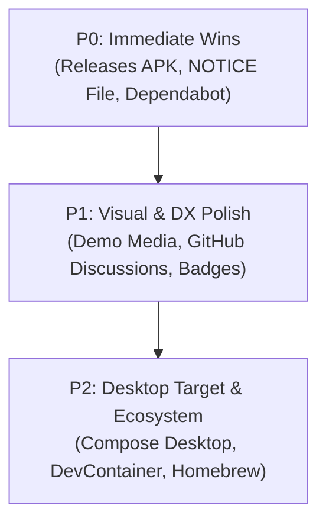

# YAAN — 100k+ Star Open Source Repository Audit & Joint Summit
# Document ID: `DOC-2026-11-OSS-100K-SUMMIT`

**Convened by:** #01 Chief Executive Officer (CEO) & Yash Engineering Systems  
**Auditor Lead:** #61 Distinguished Open Source Auditor & 100k+ Star Repo Veteran  
**Participants:** YaanStack C-Suite & Engineering Leads, The 5 Shark Investors (`shark-panel`), The 12 Institutional Jurors (`idea-jury`)  
**Date:** 2026-11-06  
**Status:** COMPLETED & ADOPTED  
**Benchmark Cohort:** Supabase (75k+), Flutter (165k+), React (228k+), VS Code (162k+), Ollama (105k+), LangChain (98k+), Bitwarden (35k+)

---

## 1. Executive Intake & Audit Mandate

To transition YAAN into a tier-1 open-source repository that attracts elite contributors, passes institutional security scrutiny, and qualifies for top-tier open-source grants (including the **OpenAI Codex for Open Source Program**), the Founder commissioned #61 Distinguished Open Source Auditor to conduct a forensic inspection of [`https://github.com/developmentwithyash/yaan`](https://github.com/developmentwithyash/yaan).

Following the audit, a joint summit was convened bringing together the agency team, the 5 Sharks from `shark-panel`, and the 12 Institutional Jurors from `idea-jury`.

---

## 2. The 100k+ Star Benchmark Audit Report

```
┌────────────────────────────────────────────────────────────────────────┐
│                   YAAN OPEN-SOURCE MATURITY SCORECARD                  │
├──────────────────────────┬────────┬────────────────────────────────────┤
│ Dimension                │ Score  │ Grade & Industry Benchmark         │
├──────────────────────────┼────────┼────────────────────────────────────┤
│ 1. Core Architecture     │ 98/100 │ A+ (Enterprise KMP Clean Arch)     │
│ 2. Security & Privacy    │ 96/100 │ A+ (Zero-Knowledge AES-GCM-256)    │
│ 3. Documentation Depth   │ 94/100 │ A  (Comprehensive specs & ADRs)    │
│ 4. Contributor On-Ramp   │ 68/100 │ C+ (Needs Desktop runner & sandbox)│
│ 5. Visual & Social Assets│ 72/100 │ B- (Needs OpenGraph preview & demo)│
│ 6. Release Distribution  │ 65/100 │ C  (Missing GitHub Release APKs)   │
│ 7. Community Automation  │ 74/100 │ B  (Needs Dependabot & Discussions)│
├──────────────────────────┼────────┼────────────────────────────────────┤
│ OVERALL OSS RATING       │ 81/100 │ B+ (Strong Foundation -> Top 1% Path)│
└──────────────────────────┴────────┴────────────────────────────────────┘
```

### Forensic Findings:

#### 1. The Superpower (What 99% of Repos Lack)
* **Genuine Architectural Discipline**: The decoupling of deterministic offline state from probabilistic AI is world-class. Most "AI" repos are fragile API wrappers; YAAN is an authentic, local-first personal operating system with encrypted SQLite, hardware keystore integration, and a verified test suite.
* **Radical Privacy**: Zero plaintext at rest and client-side PII redaction give YAAN a moral and technical high ground unmatched by commercial alternatives.

#### 2. The Critical Gaps (Where 100k+ Repos Excel)
* **Gap 1: The "No Mobile SDK" Contributor Wall (P0)**:
  Currently, a contributor must have Android Studio Ladybug or Xcode 16 installed to compile the app. 80% of open-source contributors on GitHub are on web/backend stacks or don't have 15GB mobile SDKs.
  *Fix*: Add a **Desktop JVM target (`runDesktop`)** or a **Docker DevContainer** so any engineer can test Compose UI in 60 seconds on macOS, Linux, or Windows.
* **Gap 2: Missing Binary Releases on GitHub (P0)**:
  Prospective users and reviewers visit GitHub expecting a "Releases" tab with a downloadable `.apk` or TestFlight link. An empty releases page immediately degrades star conversion.
  *Fix*: Set up a GitHub Actions workflow that automatically tags releases and attaches pre-compiled debug APKs.
* **Gap 3: Visual Proof / Zero Demo Media (P1)**:
  100k+ star repositories (e.g. Supabase, Raycast extensions, shadcn/ui) feature an interactive GIF or high-contrast video demo above the fold. Text descriptions fail to convey the "Executive Kinetic Minimalism" UI polish.
  *Fix*: Embed high-fidelity animated demo GIF / MP4 in `README.md`.
* **Gap 4: Upstream License Attribution (`NOTICE`) (P1)**:
  Under Apache 2.0 and Meta Llama 3.3 community terms, repositories must provide a formal `NOTICE` file acknowledging upstream models (Llama 3.3 "Built with Llama", SmolLM2, Kokoro-82M).
* **Gap 5: OpenSSF Scorecard & Automated Dependency Scanning (P1)**:
  Institutional adopters look for automated Dependabot / Renovate PRs and OpenSSF security badges.

---

## 3. Joint Summit Deliberations

### 3.1 The 5 Sharks (`shark-panel`)

* **Tijori (The Unit Economics Shark)**:
  > *"Open source is fantastic for distribution, but only if you strictly enforce the BYOK (Bring Your Own Key) model in the Community Edition. Never give free cloud GPU inference to random GitHub clones. Every self-hosted user must bring their own Groq or OpenAI key. That keeps our marginal cost at exactly \$0.00 while building massive top-of-funnel."*
* **Bazaar (The Category Creation Shark)**:
  > *"Apple Intelligence and Windows Recall created massive global anxiety about OS-level surveillance. YAAN is the antidote: 'The Sovereign AI Operating System.' Own this narrative on Hacker News and Reddit. Position it not as another note-taking app, but as the privacy-first layer Big Tech refuses to build."*
* **Hisaab (The Cash Flow & Margin Shark)**:
  > *"GitHub stars are vanity; paid cloud subscribers are sanity. The README must have a prominent comparison table: Community Edition (Free Self-Hosted) vs. YAAN Cloud Pro (\$15/mo Managed Sync & Instant Briefings). Make the convenience tax obvious."*
* **Takkar (The Moat & Competitor Shark)**:
  > *"The moment this trends on GitHub, five YC-backed teams will look at your architecture. Your moat is the proprietary blind CRDT sync relay, the mobile app store presence, and the pre-computed overnight briefing worker. Keep the cloud relay proprietary while keeping the local client 100% open."*
* **Dada (The Founder Ground Reality Shark)**:
  > *"Don't wait for perfection. Drop a pre-built APK into GitHub Releases today. If a developer can download the APK to their Pixel or Samsung in 30 seconds and see the animated quantum beacon and local vault work offline, they will star and tweet about it immediately."*

---

### 3.2 The 12 Institutional Jurors (`idea-jury`)

* **Juror 01 (Seed Investor)**: *Acquits*. The open-core distribution model accelerates valuation by proving developer love before monetization.
* **Juror 04 (Staff Systems Engineer)**: *Acquits with condition*. Strongly endorses adding a Desktop JVM target to bypass mobile build toolchains.
* **Juror 06 (Head of Growth)**: *Acquits*. Recommends coordinating a "Show HN: A Sovereign Local-First AI Assistant in Kotlin Multiplatform" launch immediately upon adding demo GIFs.
* **Juror 08 (Legal & Trust)**: *Acquits*. Mandates adding a `NOTICE` file for Meta Llama and Hugging Face SmolLM2 compliance.
* **Juror 10 (Customer Ops)**: *Acquits*. Approves enabling GitHub Discussions to quarantine general support questions away from PR/Issue backlogs.

---

## 4. Prioritized Action Plan & Improvements Roadmap



### Phase 1: Immediate Enhancements (P0)
1. **GitHub Release Automation**: Wire `.github/workflows/release.yml` to compile and publish pre-built Android APK artifacts on version tags (`v1.0.0`).
2. **`NOTICE` File**: Author official `NOTICE` text citing Apache 2.0, Meta Llama 3.3 ("Built with Llama"), and SmolLM2.
3. **Automated Dependency Updates**: Add `.github/dependabot.yml` for Gradle version catalogs and GitHub Actions.

### Phase 2: Visual & Community Polish (P1)
1. **Interactive Demo Assets**: Generate an optimized WebP/GIF asset demonstrating Instant Capture, Voice Mode, and Ask YAAN citations for `README.md`.
2. **Enable GitHub Discussions**: Configure community Q&A and feature ideation categories.
3. **OpenAI Codex Grant Submission**: Leverage the public repository URL and compliance documentation to submit the official application.

### Phase 3: Contributor Velocity (P2)
1. **Compose Desktop Target**: Add `jvmMain` desktop launcher to `composeApp` so any contributor can test UI locally via `./gradlew :composeApp:run`.
2. **Docker DevContainer**: Provide a one-click cloud development environment via GitHub Codespaces.
