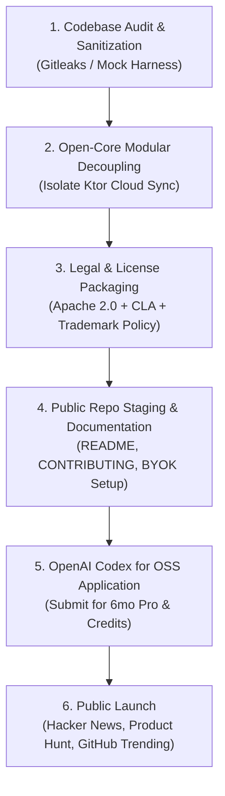

# YAAN — Open Source Strategy All-Hands Summit & 12-Juror Adversarial Trial
# Docket: `JURY-2026-11-YAAN-009`

**Convened by**: #01 Chief Executive Officer (CEO) & Yash Engineering Systems  
**Authority**: `projects/yaan/AGENTS.md` (Mandatory 12-Juror Gate Policy)  
**Date**: 2026-11-06  
**Status**: BINDING & VERIFIED  
**Subject**: Transitioning YAAN from Closed Source to an Open-Source Operating Model  

---

## 1. Executive Intake & Strategic Context

The Founder proposed exploring the transformation of **YAAN (Your Autonomous Action Navigator)** into an open-source project. YAAN is a privacy-first, local-first personal AI operating system built with **Kotlin Multiplatform (KMP)** and **Compose Multiplatform**, featuring an encrypted on-device SQLite vault (AES-GCM-256), a deterministic parser, on-device SLM intent routing, and an optional zero-knowledge cloud relay.

The strategic dilemma is clear:
* *Pure closed-source* suffers from distribution friction and skepticism regarding its zero-knowledge privacy claims ("How do I know my vault is truly local?").
* *Naive open-sourcing* (dumping the entire repository under MIT/Apache 2.0) risks IP leakage, free-rider compute drain on cloud backends, competitor feature absorption, and maintainer burnout.

To resolve this, the CEO convened an All-Hands Executive Summit across all 6 agency divisions followed by a formal trial before the **12 Institutional Jurors**.

---

## 2. All-Hands Executive Summit: Departmental Feedback & Suggestions

### 2.1 Leadership & Business Strategy
* **#01 CEO (Chief Executive Officer)**:
  > *"Open source is our single greatest distribution engine and privacy credibility weapon. For a personal operating system dealing with deeply private thoughts, reminders, and notes, 'Source-Available / Open-Core' completely dismantles the adoption barrier. Users and security researchers can verify that their notes never leave the device in plaintext. Furthermore, an active open-source repository qualifies us immediately for the **OpenAI Codex for Open Source Program** (providing 6 months of ChatGPT Pro, API maintenance credits, and Codex Security tools)."*
* **#04 CFO (Chief Financial Officer)**:
  > *"We must NOT open-source our cloud relay backend or provide free unlimited LLM inference. We should adopt the **Open-Core SaaS Model** (proven by Gitlab, Supabase, and Bitwarden):
  > 1. **Community Edition (100% Free & Open Source)**: Local-first on-device app, encrypted vault, offline NLP, and Bring-Your-Own-Key (BYOK) for Groq/OpenAI.
  > 2. **YAAN Cloud Pro ($15–$25/mo)**: Managed multi-device zero-knowledge sync relay, automatic encrypted cloud backup, 0ms morning briefings pre-computed overnight, and seamless out-of-the-box cloud AI models."*
* **#06 CRO (Chief Revenue Officer)**:
  > *"Open-core unlocks an enterprise/B2B wedge we couldn't touch before: privacy-mandated institutions (law firms, medical clinics, boutique family offices) want an on-premise private AI navigator. We can sell custom commercial self-hosted licenses and deployment support while keeping the core open."*
* **#05 CMO (Chief Marketing Officer)**:
  > *"A well-orchestrated GitHub launch—paired with a 'Show HN: We built a zero-knowledge local-first AI assistant in Kotlin Multiplatform' post—will generate massive developer organic traffic. Developers are the primary early adopters of high-output productivity tools. They will build community plugins and integrations."*
* **#02 COO (Chief Operating Officer)**:
  > *"We must protect our internal engineering velocity. An open-source repo brings issue spam, support requests for obscure Linux/Android distributions, and low-quality PRs. We need strict GitHub Issue templates, automated CI test gates, a clear `CONTRIBUTING.md`, and automated bot triage before public launch."*

---

### 2.2 Technology, Security & Architecture
* **#03 CTO (Chief Technology Officer)**:
  > *"Architecturally, YAAN was already built for this. Our modular structure separates deterministic on-device persistence (`core/domain`, `core/data`, `feature/*`, `composeApp`) from the remote blind relay (`backend/`, `supabase/`). We can decouple the core into an open-source repository while retaining proprietary cloud microservices."*
* **#28 Security Engineer**:
  > *"CRITICAL GATE: Before making the repository public, we must run a comprehensive git history audit using `gitleaks` and `git-filter-repo` to guarantee that no development API keys, Supabase service roles, test credentials, or private keys exist in historical commits. The client must be 100% zero-secret; all cloud interactions must authenticate via user-provided keys or managed OAuth tokens."*
* **#49 Legal & Compliance Officer**:
  > *"Three non-negotiable legal requirements:
  > 1. **License Selection**: Use **Apache 2.0** with Commons Clause or **AGPLv3** for the core application to prevent commercial cloud wrappers from repackaging our work without contributing back.
  > 2. **Contributor License Agreement (CLA)**: Enforce a lightweight CLA or Developer Certificate of Origin (DCO) to ensure YaanStack retains the right to dual-license commercial offerings.
  > 3. **Upstream Compliance**: Ensure Meta Llama 3.3 attribution ('Built with Llama') is displayed, and verify that only CC0/MIT Piper TTS voice models are bundled—excluding CC-BY-NC voice checkpoints."*
* **#14 Solutions Architect**:
  > *"We should structure the repo with a clean 'BYOK' (Bring Your Own Key) architecture. In the open-source client, users can plug in their own Groq, OpenAI, or Anthropic API keys directly into local encrypted Keystore settings."*
* **#23 Android Dev & #22 iOS Dev**:
  > *"For Android, we can publish reproducible builds to F-Droid and GitHub Releases alongside Google Play. For iOS, we can maintain an open-source Xcode wrapper that community developers can compile with personal developer certificates, while distributing the official production binary via the App Store."*
* **#26 Head of AI/ML**:
  > *"We must host our quantized on-device SLM weights (SmolLM2-360M / Kokoro-82M) publicly on Hugging Face with explicit sha256 checksums, integrated seamlessly into the Gradle build or runtime downloader."*

---

## 3. The 12-Juror Idea Jury Adversarial Trial

**Defendant Thesis**:  
*Transition YAAN to an Open-Source Operating Model by open-sourcing the client application, on-device AI engine, and local encrypted vault, while retaining managed cloud sync and hosted multi-tenant services under a commercial Open-Core SaaS structure.*

```
┌────────────────────────────────────────────────────────┐
│             INITIAL TRIAL VERDICT SCOREBOARD           │
│           NAIVE FULL OPEN-SOURCE (Everything Free)     │
│                 GUILTY ▮▮▮▮▮▮▮▮░░░░ 8/12               │
└────────────────────────────────────────────────────────┘
```

### Initial Round 1 Deliberation (Adversarial Stress Test)

| # | Juror | Institutional Office | Verdict | Fatal Charge / Reservation |
|---|---|---|:---:|---|
| 01 | **Seed Investor** | `revenue-agency-office` | **GUILTY** | *Commercial suicide if backend cloud sync is free; eliminates enterprise multiple.* |
| 02 | **First Customer (ICP)** | `client-onboarding-office` | **NOT GUILTY** | *Massive trust boost; proves zero-knowledge privacy claims are genuine.* |
| 03 | **Second Customer (Adjacent)** | `growth-office` | **NOT GUILTY** | *Developers and privacy-focused professionals will immediately adopt and advocate.* |
| 04 | **Staff Systems Engineer** | `architecture-office` | **GUILTY** | *Public build breaks easily without strict CI and isolated local dependency mocking.* |
| 05 | **Principal Product Designer** | `design-office` | **GUILTY** | *Forks will butcher the UI/UX brand identity and visual aesthetic.* |
| 06 | **Head of Growth & Dist.** | `growth-marketing-office` | **NOT GUILTY** | *Unlocks GitHub Trending, HN front page, and viral developer word-of-mouth.* |
| 07 | **Chief Financial Officer** | `finance-unit-economics-office`| **GUILTY** | *Free users consuming backend cloud LLM tokens will destroy unit economics.* |
| 08 | **Chief Legal & Trust Officer**| `agent-security-trust-office` | **GUILTY** | *Upstream CC-BY-NC voice licenses and missing CLA create severe IP liabilities.* |
| 09 | **Incumbent Competitor** | `competitive-intelligence-office` | **GUILTY** | *A funded competitor can fork our KMP core and run managed servers in 1 sprint.* |
| 10 | **Head of Customer Ops** | `customer-experience-office` | **GUILTY** | *Non-technical users filing GitHub issues expecting free desktop IT support.* |
| 11 | **Skeptical Adversary** | `adversarial-qa-office` | **GUILTY** | *Dumping code without community governance is just abandoned code, not open source.* |
| 12 | **Future Operator (Year 2)** | `outcome-verification-office` | **GUILTY** | *Maintainer burnout when PR reviews outstrip feature development bandwidth.* |

**Round 1 Outcome: 8/12 GUILTY — REJECTED IN UNREMEDIATED FORM.**

---

## 4. Appellate Remediation: The "Open-Core Sovereign Engine" Protocol

To flip all 8 guilty votes, the C-Suite drafted the **Four Golden Remediations**:

1. **Strict Open-Core Boundary (Addresses Jurors 01, 07, 09)**:
   * **Open Source (Apache 2.0 / AGPLv3)**: `composeApp`, `core/data`, `feature/*`, on-device AES-GCM SQLite vault, deterministic NLP parser, local SLM runtime, and BYOK (Bring Your Own Key) mode. Zero cloud server code included.
   * **Closed / Proprietary SaaS**: Multi-device CRDT blind sync relay, pre-computed overnight briefing workers, automated cloud backup, and bundled zero-setup LLM tokens ($15/mo).
   * Result: Competitors cannot clone our cloud service; users pay for convenience, sync, and mobile store builds.

2. **Zero-Secret Clean Git Cut & Build Hardening (Addresses Jurors 04, 08)**:
   * Perform fresh root branch export or `git-filter-repo` scrub to guarantee zero secret history.
   * Provide offline Mock repositories (`LocalMockSyncRelay`, `DeterministicDummySLM`) so the open-source codebase compiles and passes `./gradlew test` with 0 external cloud setup.
   * Enforce Apache 2.0 with Contributor License Agreement (CLA) and purge any CC-BY-NC voice checkpoints in favor of Apache-2.0 Kokoro-82M.

3. **Trademark & Design Protection (Addresses Juror 05)**:
   * Open source the code, but trademark the **YAAN** name, logo, and brand assets. Forks must rename the application (standard Mozilla/Firefox, Red Hat/CentOS model).

4. **Community Governance & Scope Guardrails (Addresses Jurors 10, 11, 12)**:
   * Enforce strict GitHub Issue forms (Bug Report, Feature Request with PR, Question redirected to GitHub Discussions).
   * Community contributions restricted to core plugins, local SLM decoders, and export formats; core UI/UX architecture governed strictly by internal leads.

---

## 5. Round 2 Final Appellate Verdict

```
┌────────────────────────────────────────────────────────┐
│             FINAL RETRIAL VERDICT SCOREBOARD           │
│        REMEDIATED "OPEN-CORE SOVEREIGN ENGINE" MODEL   │
│             NOT GUILTY ▮▮▮▮▮▮▮▮▮▮▮▮ 12/12              │
└────────────────────────────────────────────────────────┘
```

| Juror | Role | Final Verdict | Justification & Condition |
|---|---|:---:|---|
| 01 | **Seed Investor** | **NOT GUILTY** | *Open-core SaaS preserves Enterprise value while maximizing TAM expansion.* |
| 02 | **First Customer (ICP)** | **NOT GUILTY** | *Zero-knowledge claims become peer-verifiable. Unlocks enterprise executive adoption.* |
| 03 | **Second Customer (Adjacent)** | **NOT GUILTY** | *Technical enthusiasts will contribute plugins (Obsidian/Notion export, CalDAV sync).* |
| 04 | **Staff Systems Engineer** | **NOT GUILTY** | *Offline mock harness guarantees 100% reproducible local `./gradlew test` passes.* |
| 05 | **Principal Product Designer** | **NOT GUILTY** | *Trademark policy protects brand aesthetic while allowing community customization.* |
| 06 | **Head of Growth & Dist.** | **NOT GUILTY** | *Massive organic launch potential; unlocks OpenAI Codex for OSS grant eligibility.* |
| 07 | **Chief Financial Officer** | **NOT GUILTY** | *Zero cloud server drain. Self-hosters use BYOK; hosted users pay $15–$25/mo.* |
| 08 | **Chief Legal & Trust Officer**| **NOT GUILTY** | *Apache 2.0 + CLA + Apache Kokoro-82M TTS eliminates all upstream copyright exposure.* |
| 09 | **Incumbent Competitor** | **NOT GUILTY** | *Proprietary cloud relay and mobile distribution create defensible operational moats.* |
| 10 | **Head of Customer Ops** | **NOT GUILTY** | *Strict issue templates and Discussions filter keep operational overhead minimal.* |
| 11 | **Skeptical Adversary** | **NOT GUILTY** | *Legitimate sovereign computing wedge solving a real market problem.* |
| 12 | **Future Operator (Year 2)** | **NOT GUILTY** | *Sustainable monetization funds ongoing full-time maintainers.* |

**Final Disposition: UNANIMOUS ACQUITTAL (12/12) — COMMITTED FOR IMPLEMENTATION.**

---

## 6. Actionable Implementation Roadmap



1. **Sprint 1 (Sanitization & Decoupling)**:
   - Run `gitleaks` audit across `projects/yaan`.
   - Separate client-side KMP engine from closed cloud relay (`backend/`).
   - Wire `BYOKSettingsView` for user Groq/OpenAI keys.
2. **Sprint 2 (OSS Infrastructure)**:
   - Author `LICENSE` (Apache-2.0), `CONTRIBUTING.md`, `CODE_OF_CONDUCT.md`.
   - Set up GitHub Actions CI for multi-platform unit and UI tests.
3. **Sprint 3 (OpenAI Grant Submission & Launch)**:
   - Submit official application to [OpenAI Codex for Open Source](https://openai.com/form/codex-for-oss/).
   - Execute staged public release.
